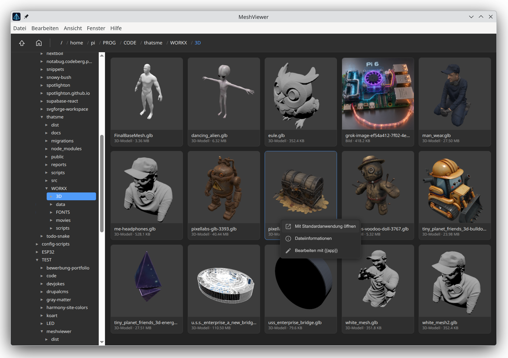
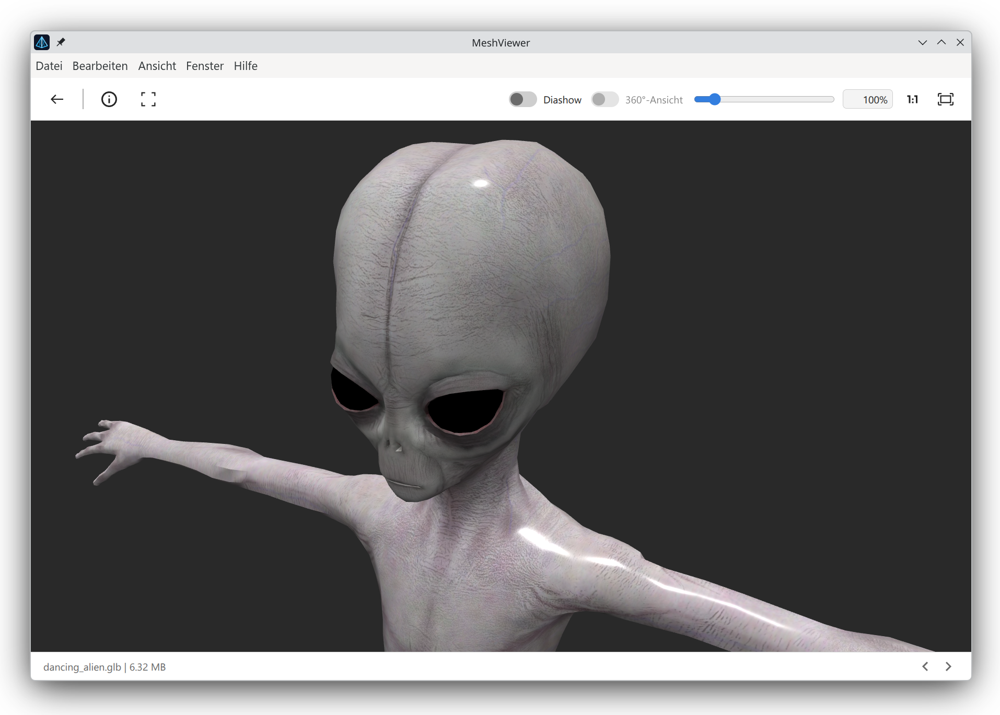
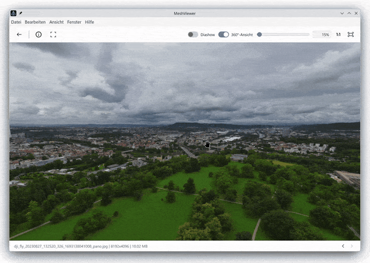

# Meshviewer

[](https://github.com/SpotlightOn/meshviewer/actions/workflows/ci.yml)
[](https://github.com/SpotlightOn/meshviewer/actions/workflows/codeql.yml)
[](https://github.com/SpotlightOn/meshviewer/releases/latest)
[](./LICENSE)
[](https://github.com/SpotlightOn/meshviewer/pulls)

I wanted a photo browser that’s fast and easy to use, and I had some special requirements: support for 360° images from my DJI drone and for 3D GLB files.
And how about lossless JPEG transformations?

There was no free image viewer that supported all of the above.

Meshviewer even **supports lossless JPEG XL transformations** — I believe it’s one of the first apps with a UI for them. A JPEG XL crop is never final: the pixels stay in the file, so one click brings the whole image back.

If you don’t know JPEG XL yet: it’s a new image format that can take an existing JPEG, re-encode it into a `.jxl` file roughly 20–30 % smaller, and reconstruct the original JPEG byte for byte on demand.

There’s still plenty I’d like to improve, but it’s already working really well — and advanced caching keeps it speedy.
Enjoy a modern photo browser with an old-fashioned feel — and a real 3D viewer. Open GLB models as interactive Three.js scenes you can rotate, pan, and zoom from any angle.

Have an idea? Open an issue, and let’s see what we can do.

**Short description**:
An Electron app that renders local .glb files as thumbnails using Three.js and GLTFLoader, displays 360° panoramas, and supports SVGs and most common image formats.

[](./docs/screen.png) [](./docs/screen2.png)



## Features

- **3D models (`.glb`)** — grid thumbnails rendered with three.js/GLTFLoader; the large view is an interactive scene (orbit, pan, zoom)
- **360° panoramas** — equirectangular images get a panorama mode from the switch in the header: drag to look around, the wheel or the zoom slider changes the field of view
- **Many image formats** — PNG, APNG, JPEG, GIF, WebP, AVIF, BMP, SVG, ICO and JPEG XL
- **Fast thumbnails** — 256 px JPEGs from `sharp`, reusing the freedesktop thumbnail cache and embedded EXIF thumbnails; loaded lazily as they scroll into view, with EXIF orientation applied
- **Folder tiles** — subdirectories are listed first, each tile showing the folder's first image inside a folder-shaped frame
- **Directory tree** — rooted at `/`, children loaded lazily with a bounded prefetch, resizable sidebar with a remembered width
- **Grid zoom** — `Ctrl` + mouse wheel or `+` / `-` change the tile size, `0` resets it
- **Multi-selection** — Ctrl/Cmd-click toggles, Shift-click selects a range, rubber-band drag over empty space, Ctrl+A selects all, Esc clears
- **File operations** — copy, cut, paste, move to trash (a folder asks first), create and delete folders, optional checksum verification for moves
- **Context menus** — open with the default application, edit with a configurable editor command, file information, new folder, cut/copy/paste, move to trash
- **Large view** — keyboard navigation, previous/next arrows, horizontal swipe, middle-click toggles 100 %/fit, zoom slider 10–800 % with typed values, fit-to-screen and 1:1 buttons, fullscreen, status bar with name, dimensions and size
- **Slideshow** — fade or slide transition with configurable interval and animation duration, progress line in the header
- **File information dialog** — all EXIF groups of an image plus basic file information, with the embedded preview shown as an image
- **Lossless rotation and flip** — rotate left/right and mirror horizontally/vertically in the large view rewrite `.jpg`/`.jpeg` in place without recompressing (EXIF and the other markers survive) and turn a `.jxl` through its orientation tag with the pixels untouched; it runs in-process through the bundled `@chimok/jpegtran-js` and `@chimok/jxltran-js` WebAssembly modules
- **Lossless crop** — a crop mode in the large view whose selection snaps to the iMCU grid of a JPEG, so the result is exactly the area that was picked; it is written as `<name>-crop-<n>.jpg`/`.jxl` next to the source, which stays untouched. A JPEG XL crop is a metadata-only canvas resize (animations are excluded)
- **Lossless crop undo (JPEG XL)** — a `.jxl` crop only shrinks the canvas and keeps every pixel in the file, so the Undo button in the large view saves the whole image as a new `<name>-undo-<n>.jxl`, without decoding or recompressing anything
- **Path bar** — clickable breadcrumbs, up and home buttons, and a path field for typed or pasted paths
- **Settings** — color scheme, tile open behavior, thumbnail fit, transparency background, editor command, slideshow, checksum verification
- **Help** — the full shortcut and gesture reference (`Help → Usage`) and the About window with version and license

## Install

Release binaries are built for Linux (AppImage), Windows (NSIS installer, portable, ZIP) and macOS (arm64 and x64 DMG).

The Windows builds are not code-signed, so SmartScreen shows a warning on the
first start: click **More info** and then **Run anyway** to confirm. Prefer the
NSIS **Setup** over the portable/ZIP build: it starts faster because the
portable and ZIP variants have to unpack their contents on every launch.

## Running from sources

```bash
pnpm install
pnpm start
```

The tree on the left is rooted at `/`, the arrow button goes one level up and
Home jumps to the user directory. Media is previewed in the grid: GLB models
are rendered as thumbnails, images are shown directly, and subdirectories
appear as folder tiles. Double-clicking a tile opens the large view (the “File
operations” setting can switch the grid to single-click opening); the back
arrow or `Esc` returns to the list. The large view shows the file name, its
dimensions and the size in a status bar, and fullscreen hides both bars until
the mouse moves.

## Controls

Keyboard shortcuts and mouse gestures are listed in
[`docs/usage.md`](./docs/usage.md) — and the same reference is available in the
app under *Help → Usage*.

## Supported Formats

- **3D models**: `*.glb` (GLTF Binary), rendered with three.js/GLTFLoader
- **Images**: `*.png`, `*.apng`, `*.jpg`, `*.jpeg`, `*.gif`, `*.webp`, `*.avif`, `*.bmp`, `*.svg`, `*.ico`, `*.jxl`

Image formats are decoded directly by the Chromium/Electron image decoder. JPEG XL (`*.jxl`) is gated behind the Chromium `JXLImageFormat` feature, which the app switches on (Chromium 155 enables it by default). HEIC/HEIF is not supported by Electron on Linux/Windows.

## Localization

The UI is English by default; German is provided as a translation via i18next. The language follows the system locale (`app.getLocale()`). Pull requests for new translations are welcome.

## Documentation

- [`docs/usage.md`](./docs/usage.md) – keyboard shortcuts and mouse gestures
- [`docs/architecture.md`](./docs/architecture.md) – modules and design notes
- [`docs/conventions.md`](./docs/conventions.md) – naming and module conventions

## Structure

- `src/main.js` – Main process: custom protocol `app://`, filesystem IPC, CSP header
- `src/preload.js` – secure API bridge (`contextBridge`)
- `src/renderer/` – UI with three.js thumbnail rendering
